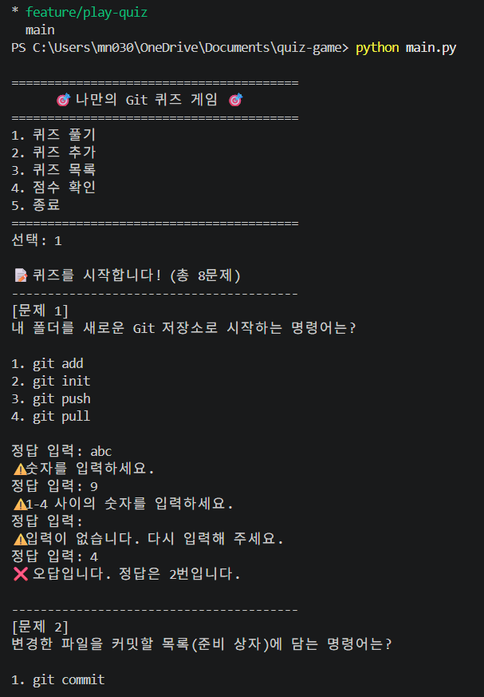
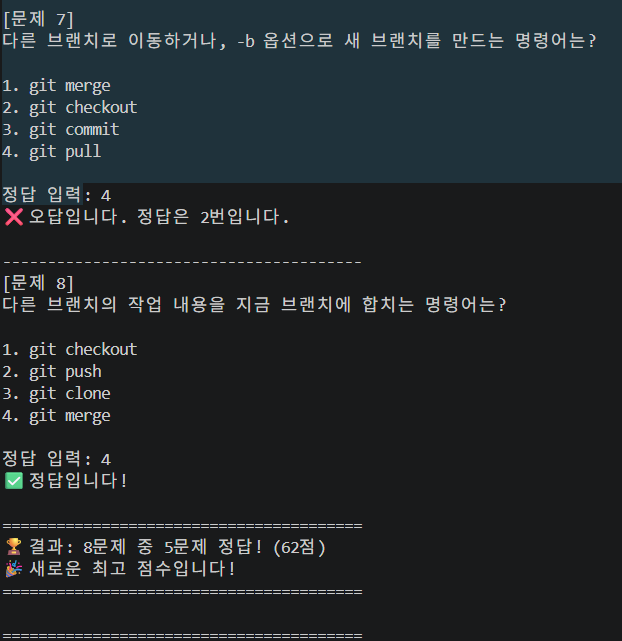
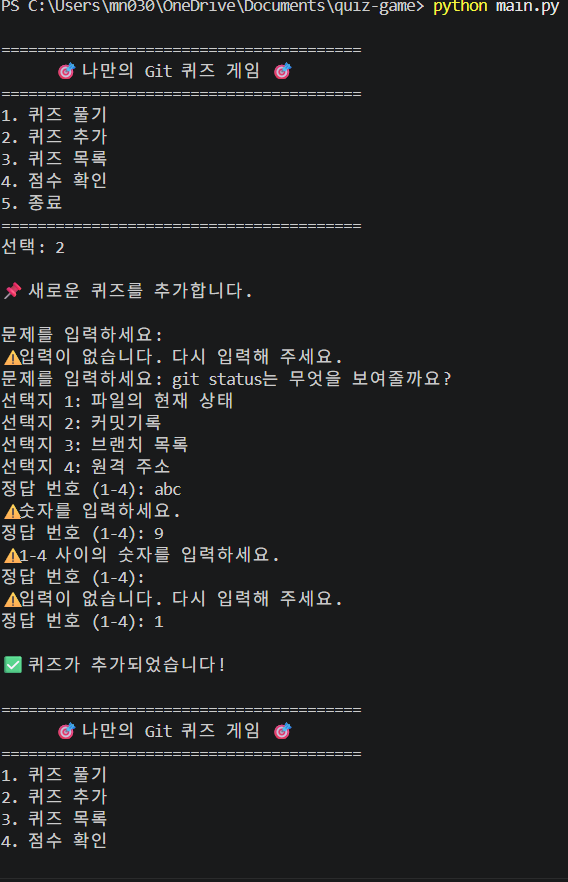
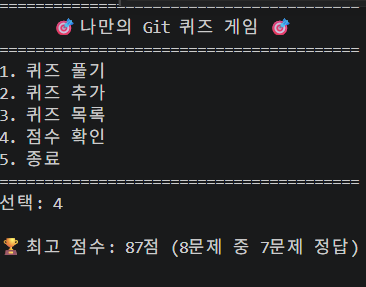
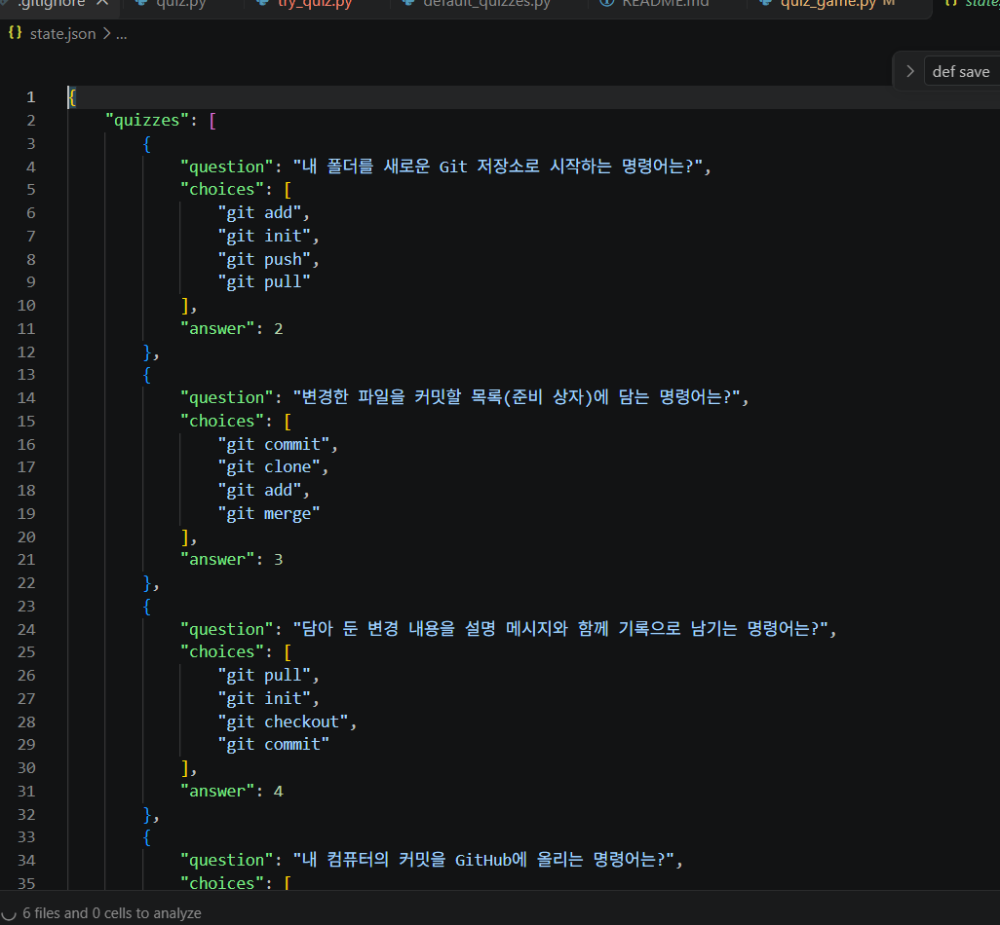
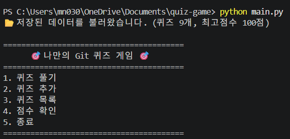
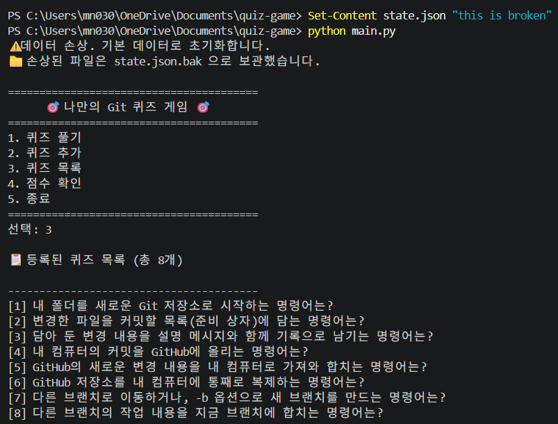
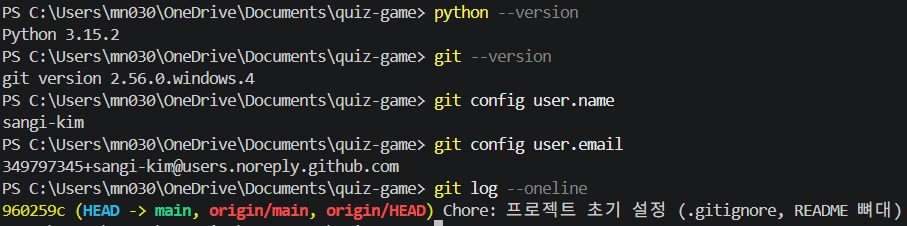
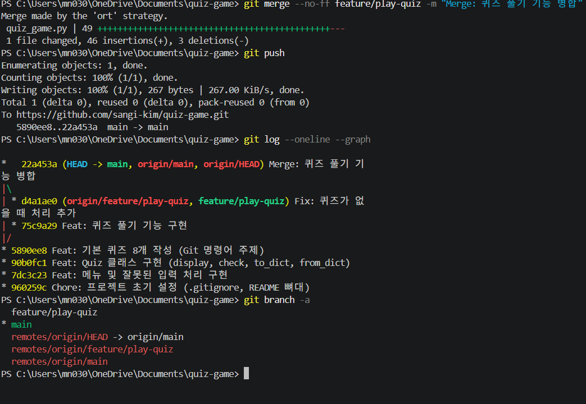

# 나만의 Git 명령어 퀴즈 게임

GitHub 저장소: https://github.com/sangi-kim/quiz-game

## 1. 프로젝트 개요

터미널(콘솔)에서 실행하는 **Python 퀴즈 게임**입니다. 메뉴에서 번호를 골라 퀴즈를 풀고, 새 퀴즈를 추가하고, 퀴즈 목록과 최고 점수를 확인할 수 있습니다. 프로그램을 끄고 다시 켜도 추가한 퀴즈와 최고 점수가 `state.json` 파일에 저장되어 유지됩니다.

- 개발 환경: Python 3.10 이상, 외부 라이브러리 없음 (표준 라이브러리만 사용)
- 클래스 2개: `Quiz`(퀴즈 한 문제), `QuizGame`(게임 전체 관리)

## 2. 퀴즈 주제와 선정 이유

**주제: Git 명령어** (`init`, `add`, `commit`, `push`, `pull`, `checkout`, `merge`, `clone`)

선정 이유: 이 미션에서 직접 사용하는 명령어들입니다. 문제를 만들고 풀면서 각 명령어가 무엇을 하는지 스스로 설명할 수 있도록 복습하기 위해 골랐습니다. 기본 퀴즈는 8개이며 `default_quizzes.py`에 있습니다.

## 3. 실행 방법

```
python main.py
```

(Python 3.10 이상이 필요합니다. Windows에서 안 되면 `py main.py`)

## 4. 기능 목록

| 메뉴 | 기능 | 설명 |
|------|------|------|
| 1 | 퀴즈 풀기 | 저장된 퀴즈를 한 문제씩 풀고 정답/오답을 확인합니다. 마지막에 점수를 보여주고 최고 점수와 비교해 갱신합니다. 퀴즈가 없으면 안내합니다. |
| 2 | 퀴즈 추가 | 문제, 선택지 4개, 정답 번호를 입력받아 등록합니다. 빈 입력과 잘못된 번호는 다시 묻습니다. |
| 3 | 퀴즈 목록 | 등록된 퀴즈의 문제를 번호와 함께 보여줍니다. 퀴즈가 없으면 안내합니다. |
| 4 | 점수 확인 | 최고 점수를 보여줍니다. 아직 풀지 않았으면 안내합니다. |
| 5 | 종료 | 저장 후 종료합니다. |

공통 안전장치: 공백 제거, 빈 입력/글자 입력/범위 밖 숫자 처리, Ctrl+C와 EOF 처리, 데이터 파일이 없거나 손상된 경우 처리

## 5. 파일 구조

```
quiz-game/
├── main.py              # 시작 파일: QuizGame을 만들고 실행
├── quiz.py              # Quiz 클래스 (퀴즈 한 문제)
├── quiz_game.py         # QuizGame 클래스 (게임 전체 관리)
├── file_manager.py      # 파일 읽기/쓰기만 담당
├── default_quizzes.py   # 기본 퀴즈 8개 (Quiz 객체 목록)
├── state.json           # 저장 데이터 (실행하면 자동 생성)
├── docs/
│   └── screenshots/     # 실행 화면 캡처
├── README.md
└── .gitignore
```

## 6. 데이터 파일 설명 (state.json)

- **경로:** 프로젝트 루트의 `state.json`
- **역할:** 퀴즈 목록과 최고 점수를 저장해서, 프로그램을 껐다 켜도 데이터가 유지되게 합니다.
- **인코딩:** UTF-8 (한글이 깨지지 않습니다)

```json
{
    "quizzes": [
        {
            "question": "내 컴퓨터의 커밋을 GitHub에 올리는 명령어는?",
            "choices": ["git push", "git pull", "git clone", "git add"],
            "answer": 1
        }
    ],
    "best_score": 7,
    "best_total": 8
}
```

| 필드 | 타입 | 설명 |
|------|------|------|
| `quizzes` | list | 퀴즈 목록 |
| `quizzes[].question` | str | 문제 |
| `quizzes[].choices` | list[str] | 선택지 4개 |
| `quizzes[].answer` | int | 정답 번호 (1~4) |
| `best_score` | int | 최고 기록 때 맞힌 개수 |
| `best_total` | int | 그 기록 때 전체 문제 수 (0이면 아직 안 푼 것) |

## 7. 설계 이유

### 7-1. 왜 클래스를 썼나요?

- `Quiz`는 퀴즈 한 문제의 **데이터(문제, 선택지, 정답)** 와 **동작(출력, 정답 확인)** 을 한 덩어리로 묶습니다.
- `QuizGame`은 게임 전체(메뉴, 입력, 점수, 저장)를 관리합니다.
- 함수만 쓰면 코드가 짧지만, 데이터와 함수가 흩어져서 "이 데이터는 어떤 함수가 바꾸지?"를 찾기 어렵습니다. 클래스는 처음엔 코드가 조금 길어도, 역할이 나뉘어서 고치기 쉽습니다.
- 두 클래스의 협력 예: `QuizGame.play_quiz()`가 `Quiz.display()`로 문제를 보여주고, `Quiz.check()`로 정답을 확인합니다.

### 7-2. 왜 JSON을 썼나요?

- 사람이 읽기 쉽고(가독성), 리스트와 딕셔너리 같은 구조를 그대로 저장할 수 있습니다(구조화).
- 파이썬 표준 라이브러리(`json`)만으로 읽고 쓸 수 있어 외부 설치가 필요 없습니다.
- 한계: 저장할 때마다 파일 전체를 다시 쓰고, 읽을 때 전체를 메모리에 올립니다. 퀴즈가 수만 개로 늘거나 여러 사람이 동시에 쓰면 느려지고 충돌할 수 있습니다. 그때는 SQLite 같은 데이터베이스(DB)가 더 알맞습니다.

### 7-3. state.json 필드를 이렇게 설계한 이유

- `quizzes`: 퀴즈를 순서대로 저장해야 하고, 한 문제에 문제/선택지/정답이 함께 있어서 **중첩 구조**(리스트 안의 딕셔너리)로 묶었습니다. 문제 하나를 다룰 때 세 값이 항상 같이 움직이기 때문입니다.
- `best_score`, `best_total`: 퀴즈 개수가 바뀌어도 점수를 공정하게 비교하려고 "맞힌 개수"와 "그때의 전체 문제 수"를 같이 저장합니다. 화면에는 100점 만점 점수로 바꿔서 보여줍니다.
- `best_total == 0`이면 "아직 안 풀었음"으로 판단합니다. (0점을 받은 경우와 구분하기 위해서)
- 정답 번호는 화면에 보이는 번호(1~4)와 같은 값으로 저장해서 변환 실수를 막았습니다.

### 7-3-1. state.json을 언제 읽고 언제 쓰나요?

| 시점 | 동작 | 코드 위치 |
|------|------|-----------|
| 프로그램 시작 | 읽기 (1번만) | `QuizGame.__init__()` → `load()` |
| 퀴즈 풀기 끝 | 쓰기 | `play_quiz()` 끝 → `save()` |
| 퀴즈 추가 끝 | 쓰기 | `add_quiz()` 끝 → `save()` |
| 종료 (5번, Ctrl+C, EOF) | 쓰기 | `run()` 끝 → `save()` |

### 7-4. 책임 나누기: 입력 검사와 파일 입출력

| 일 | 담당 |
|----|------|
| 숫자 입력 검사 (공백 제거, 빈 입력, 글자, 범위) | `QuizGame.read_int()` |
| 글자 입력 검사 (공백 제거, 빈 입력) | `QuizGame.read_text()` |
| 파일 읽기/쓰기/백업 (실제 파일 접근) | `file_manager.py`의 `read_state()`, `write_state()`, `backup_broken_file()` |
| 불러온 데이터가 올바른지 판단하고 오류 안내 | `QuizGame.load()`, `Quiz.from_dict()` |
| 파일 저장 시도와 오류 안내 | `QuizGame.save()` |

### 7-5. 예외 처리 (try/except)

| 위치 | 잡는 오류 | 이유 |
|------|-----------|------|
| `read_int()` | `ValueError` | 숫자가 아닌 글자를 입력했을 때 |
| `load()` | `FileNotFoundError` | 첫 실행이라 파일이 없을 때 → 기본 퀴즈 사용 (안내 없음) |
| `load()` | `JSONDecodeError`, `UnicodeDecodeError`, `KeyError`, `TypeError`, `ValueError` | 파일 내용이 망가졌을 때 → 안내 후 기본 데이터로 초기화 |
| `load()` | `OSError` | 파일을 읽을 수 없을 때 → 안내 후 기본 데이터 사용 |
| `save()` | `OSError` | 저장할 수 없을 때 → 안내만 하고 프로그램은 계속 |
| `run()` | `KeyboardInterrupt`, `EOFError` | Ctrl+C, 입력 스트림 종료 |

### 7-6. Ctrl+C와 EOF 처리

`run()` 전체를 `try`로 감쌌기 때문에, 메뉴 선택 중이든 퀴즈 문제를 입력하는 중이든 Ctrl+C나 EOF(입력 끝)가 발생하면 안내 메시지를 출력하고 `save()`로 저장한 뒤 정상 종료합니다. (EOF 테스트: Windows에서 Ctrl+Z 후 Enter)

### 7-7. 파일 손상 시 백업과 복구

파일이 손상되면 다음과 같이 동작합니다.

1. "데이터 손상" 안내를 출력합니다.
2. 망가진 파일을 `state.json.bak`으로 이름을 바꿔 **보관**합니다. (`.gitignore`에 등록되어 있어 GitHub에는 올라가지 않습니다.)
3. 기본 퀴즈 8개로 새로 시작합니다.

**복구 방법:** `state.json.bak`을 열어 내용을 고친 뒤 이름을 `state.json`으로 바꾸면 다음 실행 때 다시 불러옵니다. 처음 상태로 되돌리고 싶으면 `state.json`을 삭제하고 실행하면 기본 퀴즈로 시작합니다.

## 8. 브랜치 전략

- `main`: 항상 동작하는 완성된 코드만 둡니다.
- `feature/play-quiz`: 퀴즈 풀기 기능을 `main`과 분리해서 개발한 브랜치입니다. 작업 중에 문제가 생겨도 `main`은 안전합니다.
- 병합 시나리오: `git checkout -b feature/play-quiz`로 브랜치를 만들어 작업 → 커밋 → `git checkout main` → `git merge --no-ff feature/play-quiz`로 합침 → `git push`
- `--no-ff`를 써서 병합 기록이 `git log --graph`에 남도록 했습니다.

## 9. 변경하고 싶을 때 수정할 곳

| 바꾸고 싶은 것 | 수정할 파일 / 메서드 |
|----------------|----------------------|
| 기본 퀴즈 | `default_quizzes.py` → `get_default_quizzes()` |
| 퀴즈 출력 모양 | `quiz.py` → `Quiz.display()` |
| 정답 판정 방식 | `quiz.py` → `Quiz.check()` |
| 퀴즈 데이터 검사 규칙 | `quiz.py` → `Quiz.from_dict()` |
| 메뉴 항목 | `quiz_game.py` → `show_menu()`, `run()` |
| 점수 계산 방식 | `quiz_game.py` → `calc_points()`, `update_best_score()` |
| 저장하는 항목 추가 | `quiz_game.py` → `save()`, `load()`, (퀴즈 항목이면) `quiz.py` → `to_dict()` |
| 저장 파일 이름/위치 | `quiz_game.py`의 `STATE_FILE`, `file_manager.py` |

## 10. 커밋 기록과 변경 파일

| # | 브랜치 | 커밋 메시지 | 변경 파일 |
|---|--------|-------------|-----------|
| 1 | main | Chore: 프로젝트 초기 설정 | `.gitignore`, `README.md` |
| 2 | main | Feat: 메뉴 및 잘못된 입력 처리 구현 | `main.py`, `quiz_game.py` |
| 3 | main | Feat: Quiz 클래스 구현 | `quiz.py` |
| 4 | main | Feat: 기본 퀴즈 8개 작성 | `default_quizzes.py` |
| 5 | feature/play-quiz | Feat: 퀴즈 풀기 기능 구현 | `quiz_game.py` |
| 6 | feature/play-quiz | Fix: 퀴즈가 없을 때 처리 추가 | `quiz_game.py` |
| 7 | main | Merge: 퀴즈 풀기 기능 병합 | (병합 커밋) |
| 8 | main | Feat: 퀴즈 추가 기능 구현 | `quiz_game.py` |
| 9 | main | Feat: 퀴즈 목록 기능 구현 | `quiz_game.py` |
| 10 | main | Feat: 점수 확인 및 최고 점수 갱신 기능 구현 | `quiz_game.py` |
| 11 | main | Refactor: QuizGame 구조 정리 | `quiz_game.py` |
| 12 | main | Feat: state.json 저장/불러오기 및 예외 처리 구현 | `file_manager.py`, `quiz_game.py`, `state.json` |
| 13 | main | Docs: README 작성 | `README.md`, `docs/screenshots/` |

## 11. 사용한 Git 명령어

| 명령어 | 사용한 곳 |
|--------|-----------|
| `git init` | 저장소 처음 만들 때 |
| `git add` / `git commit` | 기능을 만들 때마다 |
| `git push` | GitHub에 올릴 때 |
| `git checkout` | 브랜치를 만들고 이동할 때 (`-b`로 생성) |
| `git merge` | `feature/play-quiz`를 `main`에 합칠 때 |
| `git clone` | 저장소를 다른 폴더에 복제하는 실습 |
| `git pull` | 복제한 곳에서 올린 변경을 원래 폴더로 가져오는 실습 |

## 12. 실행 화면

**메뉴**



**퀴즈 풀기**



**퀴즈 추가**



**점수 확인**



**state.json 저장 내용**



**다시 실행해도 데이터가 유지됨**



**손상된 파일 처리**



**개발 환경**



**브랜치와 병합 기록**



## 13. clone / pull 실습

1. `git clone`으로 이 저장소를 `quiz-game-clone` 폴더에 복제했습니다.
2. 복제한 폴더에서 이 README를 수정하고 `git commit` → `git push` 했습니다.
3. 원래 폴더(`quiz-game`)에서 `git pull`로 이 변경을 가져와 반영된 것을 확인했습니다.